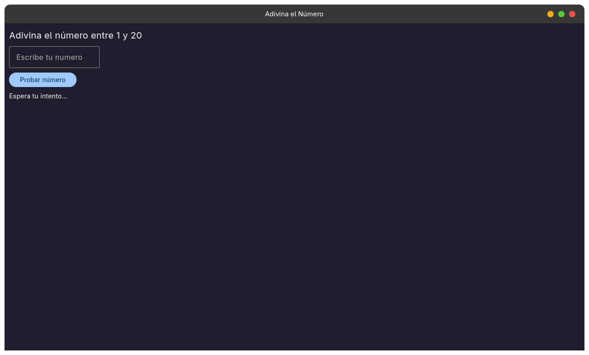
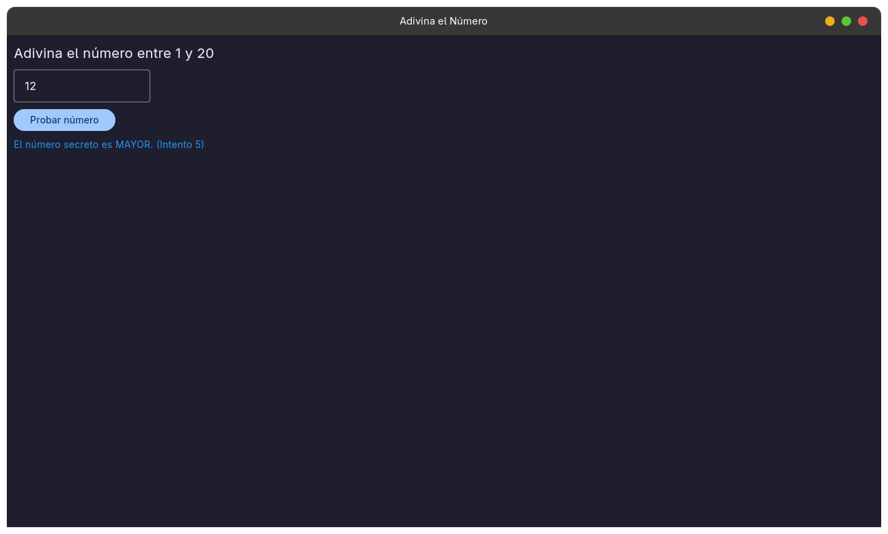
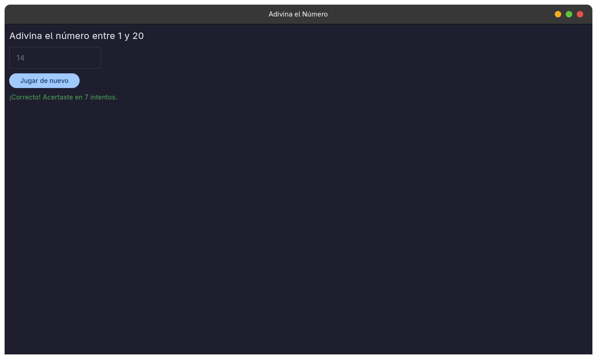

Taller de Investigación: Interfaces Gráficas en Python con Flet

Este repositorio contiene la investigación teórica y el desarrollo de una aplicación gráfica interactiva utilizando la biblioteca Flet, realizada para la asignatura de Programación Orientada a Objetos.

---

1. Investigación Teórica

¿Qué es Flet y cuál es su propósito principal?
Flet es un framework para Python que permite crear interfaces de usuario interactivas para escritorio, web y dispositivos móviles utilizando una única base de código. Su propósito es permitir el desarrollo de software frontend en Python sin requerir conocimientos en HTML, CSS o JavaScript, apoyándose en el motor gráfico de Flutter para el renderizado.

¿Qué tipo de aplicaciones permite desarrollar?
- Aplicaciones nativas de escritorio (Linux, Windows, macOS).
- Herramientas y paneles web interactivos (SPA y PWA).
- Aplicaciones móviles para Android e iOS.
- Interfaces internas, formularios de captura y herramientas de visualización de datos.

¿Cómo se instala y qué requisitos necesita?
- Requiere Python 3.10 o superior y el gestor de paquetes pip.
- Comando de instalación: pip install flet

¿Cuáles son sus principales componentes o elementos gráficos?
- Entrada de texto: TextField para recibir datos del usuario.
- Presentación: Text para etiquetas y mensajes en pantalla.
- Botones: FilledButton, ElevatedButton, TextButton e IconButton.
- Contenedores y distribución: Column, Row y Container para organizar la disposición de los elementos.

¿Cómo maneja los eventos del usuario?
Flet utiliza un esquema de programación orientada a eventos. Los componentes interactivos exponen atributos como on_click u on_change, a los cuales se les asigna una función o método callback. Al ejecutarse la acción (por ejemplo, hacer clic en un botón), Flet envía un objeto de evento a la función enlazada. Los cambios realizados en las propiedades de los controles se visualizan invocando el método page.update(), el cual redibuja el árbol de elementos.

Ventajas y limitaciones frente a Tkinter
- Diseño visual: Flet ofrece un aspecto moderno y nativo basado en Material Design y Flutter, mientras que Tkinter tiene un aspecto clásico y plano por defecto que requiere bibliotecas adicionales para verse actual.
- Soporte de plataformas: Flet funciona en escritorio, navegadores web y dispositivos móviles; Tkinter está orientado exclusivamente a entornos de escritorio.
- Manejo reactivo: En Flet se actualizan los atributos directamente y se refresca la vista con page.update(), mientras que Tkinter requiere variables de control específicas (como StringVar) o reconfiguración manual de cada componente.
- Distribución: Flet requiere instalación externa vía pip; Tkinter viene preinstalado en la biblioteca estándar de Python.
- Uso de memoria: Flet tiene un mayor consumo de recursos debido al motor embebido de Flutter; Tkinter es sumamente ligero y consume muy pocos recursos del sistema.

Fuentes consultadas
- Documentación oficial de Flet: https://flet.dev/docs/
- Repositorio de código abierto de Flet: https://github.com/flet-dev/flet

---

2. Descripción de la Aplicación (Adivina el Número y POO)

Se implementó un minijuego interactivo aplicando Programación Orientada a Objetos:

1. Al instanciarse la clase, el sistema genera un número secreto aleatorio entre 1 y 20 y establece el contador de intentos en cero.
2. El usuario introduce un número en un campo de texto y presiona el botón para comprobarlo.
3. La aplicación valida el dato, suma un intento y devuelve pistas visuales (indicando si el número secreto es mayor o menor mediante colores y texto).
4. Cuando el usuario acierta, el campo de entrada se bloquea y el botón cambia su comportamiento para permitir reiniciar la partida sin cerrar la ventana.

Estructura técnica y responsabilidades (POO)
- Ventana principal: Se inicializa mediante ft.run(main). Flet entrega una instancia de ft.Page que representa el lienzo de la ventana.
- Componentes gráficos: Se utilizan ft.Text (para títulos y pistas), ft.TextField (caja de entrada) y ft.FilledButton (botón de acción).
- Evento implementado: Evento de clic en el botón a través de la propiedad on_click.
- Métodos de respuesta:
  - comprobar_numero(self, e): Lee el valor introducido, valida que no esté vacío, evalúa las condiciones lógicas y actualiza las propiedades visuales.
  - reiniciar_juego(self, e): Restaura los valores iniciales de la clase, limpia la entrada y vuelve a habilitar los controles para una nueva partida.
- Responsabilidad de la clase JuegoAdivinaNumero: Encapsula el estado interno del juego (numero_secreto, intentos), administra las referencias a los controles y centraliza los métodos que procesan los eventos, eliminando la necesidad de variables globales.

---

3. Instrucciones de Instalación y Ejecución

Clonar el repositorio:
git clone https://github.com/Camilo045/actividad_interfacez.git
cd actividad_interfacez

Configurar entorno virtual:

En Linux o macOS:
python3 -m venv venv
source venv/bin/activate

En Windows:
python -m venv venv
venv\Scripts\activate

Instalar dependencias:
pip install -r requirements.txt

Ejecutar el programa:
python actividad.py

---

4. Evidencia de Funcionamiento

